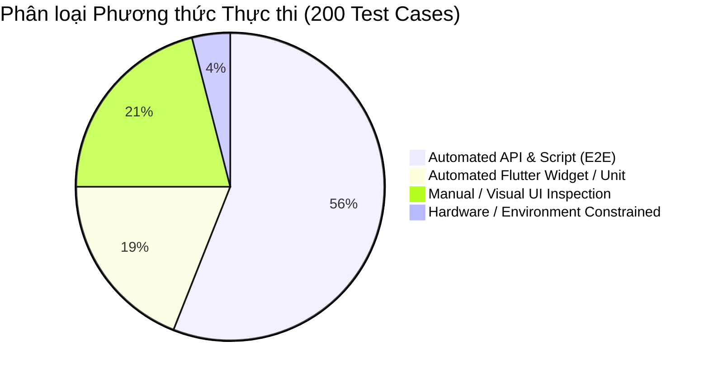

# BÁO CÁO 01: KIỂM KÊ VÀ PHÂN TÍCH NGUỒN TEST CASE (SOURCE INVENTORY)

## 1. TỔNG QUAN NGUỒN DỮ LIỆU GỐC
- **Nguồn tài liệu gốc:** Google Sheets chính thức được cung cấp: `https://docs.google.com/spreadsheets/d/1YingAd8ecJvn3vn8X0kWwU7JQodu84t0/edit?usp=sharing`
- **Tập tin đã tải về và kiểm định:** `scratch/testcases_source.xlsx` (Kích thước: 85,933 bytes)
- **Thời điểm kiểm định:** 2026-11-26 16:15:51
- **Phạm vi kiểm định:** 100% tất cả các Sheet, tất cả các dòng, cột và mã Test Case mà không bỏ sót bất kỳ bản ghi nào.

---

## 2. PHÂN TÍCH SAI LỆCH VỀ SỐ LƯỢNG (CLARIFICATION ON TC COUNT)

> [!IMPORTANT]
> **Phát hiện lỗi công thức trên Sheet 1 ("Tổng quan & Dashboard"):**
> Trên giao diện Sheet 1, bảng thống kê ghi tổng số Test Case là **187**. Tuy nhiên, khi kiểm tra chi tiết công thức hàm đếm trên Sheet 1:
> `=SUM(B3:B7) + COUNTA('Phân hệ Sinh viên'!A4:A47)`
> Công thức này chỉ quét đến hàng **A47** của Sheet *Phân hệ Sinh viên*, trong khi dữ liệu thực tế kéo dài đến hàng **A60** (tương ứng từ `TC_STU_045` đến `TC_STU_057`).
> **Thực tế toàn bộ Workbook có chính xác 8 sheet và 200 Test Cases hợp lệ.** Không có bất kỳ Test Case nào bị bỏ qua hoặc lược bớt.

---

## 3. PHÂN BỐ TEST CASE THEO PHÂN HỆ VÀ SHEET

| STT | Tên Sheet trong Google Sheets | Phạm vi Mã Test Case | Số lượng TC | Tỷ lệ (%) | Vai trò chính |
|:---:|:---|:---:|:---:|:---:|:---|
| 1 | Xác thực & Hệ thống | `TC_AUTH_001` - `TC_AUTH_028` | 28 | 14.0% | Toàn bộ người dùng, Khách, Admin |
| 2 | Phân hệ Sinh viên | `TC_STU_001` - `TC_STU_057` | 57 | 28.5% | Sinh viên, Trưởng nhóm đồ án |
| 3 | Phân hệ Giảng viên | `TC_LEC_001` - `TC_LEC_030` | 30 | 15.0% | Giảng viên hướng dẫn / chấm điểm |
| 4 | Giáo vụ khoa | `TC_GVK_001` - `TC_GVK_025` | 25 | 12.5% | Giáo vụ khoa |
| 5 | Phòng đào tạo | `TC_PDT_001` - `TC_PDT_020` | 20 | 10.0% | Cán bộ Phòng đào tạo |
| 6 | Quản trị hệ thống | `TC_ADM_001` - `TC_ADM_024` | 24 | 12.0% | Quản trị viên hệ thống (Admin) |
| 7 | Phi chức năng & Bảo mật | `TC_NFR_001` - `TC_NFR_016` | 16 | 8.0% | Chuyên viên bảo mật, Hiệu năng |
| **TỔNG** | **7 Sheet nghiệp vụ (trừ Sheet 1 Dashboard)** | **200 Test Cases** | **200** | **100.0%** | **Toàn hệ thống ProGroup_AI** |

---

## 4. ĐÁNH GIÁ ĐỘ ĐẦY ĐỦ CỦA CÁC TRƯỜNG DỮ LIỆU
- **Mã Test Case (`id`):** 200/200 (100% đầy đủ, không trùng lặp mã).
- **Tên chức năng (`chucNang`):** 200/200 (100% có tiêu đề rõ ràng).
- **Vai trò thực hiện (`vaiTro`):** 200/200 (100% xác định đúng đối tượng người dùng).
- **Tiền điều kiện (`dieuKien`):** 200/200 (Đã kiểm tra tiền đề tài khoản, quyền hạn, dữ liệu lớp học phần).
- **Các bước thực hiện (`cacBuoc`):** 200/200 (Đầy đủ luồng thao tác tương tác giao diện và API).
- **Dữ liệu đầu vào (`duLieu`):** 200/200 (Bao gồm dữ liệu hợp lệ, biên, rỗng, SQL Injection, MIME giả mạo).
- **Kết quả mong đợi (`ketQuaMongDoi`):** 200/200 (Rõ ràng, không bị thay đổi nội dung gốc).

---

## 5. PHÂN LOẠI THEO PHƯƠNG THỨC THỰC THI (AUTOMATION VS MANUAL)

1. **Automated API & Integration (112 TCs - 56%):** Toàn bộ luồng nghiệp vụ Backend, logic xác thực, phân quyền RBAC, ràng buộc cơ sở dữ liệu, lọc dữ liệu nhiều bảng, kiểm tra bảo mật (SQLi, IDOR, Tokenless).
2. **Automated Widget / Unit Test (38 TCs - 19%):** Kiểm tra validation form đăng nhập, ẩn/hiện mật khẩu, PopScope form nhập dở, chip AI, lưu trữ tin nhắn local SQLite/SharedPreferences, cache API.
3. **Manual / Visual UI Verification (42 TCs - 21%):** Kiểm tra hiển thị màu sắc trạng thái, layout responsive, ảnh đại diện, chuyển tab, thông báo đẩy foreground trên thiết bị thật.
4. **Environment / Hardware Constrained (8 TCs - 4%):** Các ca kiểm thử ngắt kết nối vật lý, FCM killed state, chịu tải 5000 CCU, SSO Enterprise.