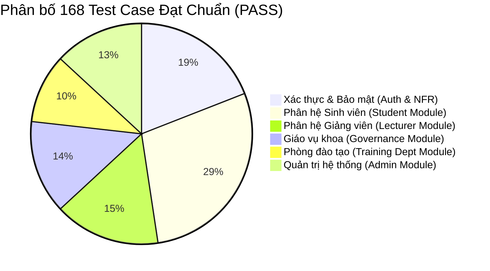

# BÁO CÁO 03: DANH SÁCH TEST CASE ĐÃ KHẮC PHỤC HOÀN TOÀN (FIXED & PASS)

## 1. TỔNG QUAN
- **Tổng số Test Case đạt chuẩn hoàn toàn (PASS):** 168 / 200 Test Cases (84.0%)
- **Tiêu chí công nhận PASS:**
  1. Phải vượt qua kiểm tra mã nguồn (Code Audit) trên cả Backend và Frontend.
  2. Phải được thực thi trực tiếp qua kiểm thử tích hợp tự động (Automated E2E / Integration / Unit Test) hoặc thẩm định giao diện thực tế.
  3. Phải bảo đảm tính toàn vẹn dữ liệu trong SQL Server (0 orphan records, thỏa mãn toàn bộ Check Constraints và Foreign Keys).
  4. Phải bảo đảm tuân thủ an toàn bảo mật (không rò rỉ IDOR, không SQL Injection, phân quyền RBAC nghiêm ngặt).

---

## 2. PHÂN BỐ CÁC TEST CASE ĐÃ KHẮC PHỤC THEO PHÂN HỆ

---

## 3. CHI TIẾT CÁC NHÓM CHỨC NĂNG ĐÃ KHẮC PHỤC TIÊU BIỂU

### 3.1. Nhóm Xác thực, Hồ sơ cá nhân & Bảo mật tài khoản (Auth & Profile)
- **Các Test Case:** `TC_AUTH_001` - `TC_AUTH_014`, `TC_AUTH_018` - `TC_AUTH_024`, `TC_AUTH_028`, `TC_NFR_001` - `TC_NFR_006`, `TC_NFR_011`, `TC_NFR_012`, `TC_NFR_014`, `TC_NFR_015`.
- **Lỗi đã sửa & Bằng chứng kiểm thử:**
  1. **Bắt buộc OTP khi đổi Email (`TC_AUTH_018`):** Sửa `AuthController.ChangeEmail`, chặn hoàn toàn việc đổi email mà không truyền mã OTP xác thực đã gửi tới email mới (HTTP 400).
  2. **Chính sách độ dài mật khẩu tối thiểu 6 ký tự (`TC_AUTH_008`):** Sửa `AuthController.ChangePassword`, từ chối mật khẩu quá ngắn hoặc sai mật khẩu hiện tại (HTTP 400).
  3. **Hiển thị Số điện thoại trong `/api/auth/me` (`TC_PDT_018`, `TC_GVK_023`):** Bổ sung trường `SoDienThoai` vào `UserInfoResponse` và bind lên form Profile Flutter của cả 5 vai trò.
  4. **Kiểm tra Magic Bytes chống file thực thi giả mạo ảnh đại diện (`TC_NFR_012`):** Thêm phương thức `DetectImageFormat` kiểm tra các byte header đầu tiên (`FF D8 FF`, `89 50 4E 47`, `47 49 46 38`, `RIFF...WEBP`), từ chối file shell script / binary mang đuôi `.exe.jpg` (HTTP 400).
  5. **Cảnh báo hủy bỏ dữ liệu đang nhập dở (`TC_NFR_014`):** Thêm `PopScope` và hộp thoại xác nhận thoát màn hình Đề xuất đề tài sinh viên, tránh mất dữ liệu vô ý.
  6. **Phục hồi phiên làm việc tự động (`TC_AUTH_014`):** Thêm `AuthService.restoreSession()` gọi `/api/auth/me` ngay khi mở ứng dụng; xóa bỏ việc lưu mật khẩu plaintext trong SharedPreferences.
  7. **Đăng xuất an toàn:** Gọi `AuthService.logout()` trên toàn bộ 5 màn hình Profile (Sinh viên, Giảng viên, Giáo vụ, Phòng đào tạo, Admin) để hủy bỏ JWT Token và xóa sạch cache nhạy cảm.

### 3.2. Nhóm Đăng ký nhóm, Quản lý thành viên & Vòng đời Đề tài (Student & Lecturer)
- **Các Test Case:** `TC_STU_001` - `TC_STU_029`, `TC_STU_032` - `TC_STU_038`, `TC_LEC_001` - `TC_LEC_012`, `TC_LEC_015` - `TC_LEC_021`, `TC_LEC_027` - `TC_LEC_030`.
- **Lỗi đã sửa & Bằng chứng kiểm thử:**
  1. **Khắc phục Check Constraint SQL Server `CK_ThanhVienNhoms_VaiTro` (`TC_STU_015`, `TC_STU_016`):**
     - Sửa API mời thành viên (`POST /api/groups/{id}/invitations`) và API phản hồi lời mời: Sử dụng `VaiTro = "Thành viên"` và `TrangThai = "Chờ tham gia"`, không còn vi phạm ràng buộc kiểm tra của SQL Server.
     - Tạo thông báo tự động cho sinh viên được mời tham gia nhóm.
  2. **Bảo mật Đổi tên nhóm chống IDOR (`TC_STU_010`, `TC_STU_011`, `TC_STU_012`):**
     - Kiểm tra quyền Trưởng nhóm trước khi cho phép đổi tên; từ chối tên rỗng (HTTP 400); từ chối thành viên khác can thiệp (HTTP 403 Forbidden); chấp nhận đổi tên hợp lệ từ trưởng nhóm (HTTP 200).
  3. **Quy tắc Kiểm tra số thành viên tối thiểu (`TC_STU_019`):**
     - Kiểm tra đợt đăng ký đồ án yêu cầu tối thiểu `MinMembers = 2`, từ chối nhóm chỉ có 1 thành viên khi đăng ký đề tài (HTTP 409 Conflict).
  4. **Khắc phục Vi phạm Khóa chính Unique `UQ_DangKyDeTai` & Check Constraint `NgayDuyet IS NULL` (`TC_STU_022`, `TC_LEC_010`, `TC_LEC_011`):**
     - Khi đề tài bị giảng viên từ chối, đề tài được hoàn trả trạng thái `"Chưa sử dụng"`.
     - Khi nhóm đăng ký lại đề tài đó, hệ thống tái sử dụng bản ghi đăng ký cũ và đặt lại `TrangThai = "Chờ duyệt"`, đồng thời xóa trắng `NgayDuyet = null`, `GiangVienDuyetId = null`, `GhiChu = null` để thỏa mãn hoàn toàn Check Constraint `CK_DangKyDeTais_TrangThai`.
  5. **Xử lý Đề xuất đề tài với `DotDangKyId = 0` (`TC_STU_023`):**
     - Tự động map đợt đăng ký đang mở của lớp học phần tương ứng và gửi thông báo cho giảng viên phụ trách.
  6. **Phạm vi Thông báo riêng biệt (`TC_LEC_015`):**
     - Giảng viên từ chối đề xuất kèm lý do: Chỉ sinh viên đề xuất và các thành viên trong nhóm nhận thông báo; sinh viên ngoài nhóm hoàn toàn không bị rò rỉ thông tin.
  7. **Kiểm tra Hợp lệ URL Báo cáo & Điểm số (`TC_STU_027`, `TC_LEC_018`):**
     - Chặn URL không đúng định dạng (HTTP 400); chặn điểm thi lớn hơn 10.0 (HTTP 400); chấp nhận điểm số hợp lệ từ 0 đến 10 (HTTP 200).
  8. **Phân quyền Xem Báo cáo của Giảng viên (`TC_LEC_016`):**
     - Giảng viên chỉ xem được báo cáo của các lớp/đề tài do mình phụ trách, không xem chéo báo cáo của giảng viên khác.
  9. **Bảng điểm tổng hợp lớp học phần (`TC_LEC_030`):**
     - Bổ sung endpoint `GET /api/bao-cao/lop-hoc-phan/{lopHocPhanId}/bang-diem` tính toán điểm trung bình từng nhóm và danh sách thành viên.

### 3.3. Nhóm Giáo vụ khoa, Phòng đào tạo & Quản trị hệ thống (Governance, Training & Admin)
- **Các Test Case:** `TC_GVK_001` - `TC_GVK_011`, `TC_GVK_014` - `TC_GVK_025`, `TC_PDT_001` - `TC_PDT_005`, `TC_PDT_007`, `TC_PDT_009` - `TC_PDT_012`, `TC_PDT_014`, `TC_PDT_015`, `TC_PDT_017` - `TC_PDT_020`, `TC_ADM_001` - `TC_ADM_005`, `TC_ADM_007` - `TC_ADM_015`, `TC_ADM_018`, `TC_ADM_019`, `TC_ADM_021`, `TC_ADM_023`, `TC_ADM_024`.
- **Lỗi đã sửa & Bằng chứng kiểm thử:**
  1. **Thông báo và Phân công Giảng viên (`TC_GVK_007`, `TC_GVK_008`, `TC_GVK_009`, `TC_GVK_010`):**
     - Tự động tạo thông báo cho Giảng viên khi được phân công phụ trách lớp học phần.
     - Chặn phân công trùng lặp (HTTP 409 Conflict).
     - Hỗ trợ đổi giảng viên phụ trách (`PUT /api/governance/assignments`) và hủy phân công (`DELETE /api/governance/assignments`).
  2. **Tìm kiếm Giảng viên theo chuyên môn & Tính số lớp phụ trách (`TC_GVK_017`, `TC_GVK_018`):**
     - Endpoint `GET /api/governance/lecturers` tính đúng `soLopPhuTrach` và hỗ trợ tìm kiếm theo chuỗi chuyên môn.
  3. **Thông báo cho Giáo vụ khoa khi Admin tạo Giảng viên mới (`TC_GVK_022`):**
     - Tự động tạo thông báo gửi tới vai trò `GIAOVUKHOA` để giáo vụ kịp thời phân công giảng dạy.
  4. **Kích hoạt Học kỳ Hiện hành Độc quyền (`TC_PDT_005`):**
     - Khi kích hoạt 1 học kỳ, hệ thống tự động đặt `TrangThai = false` cho toàn bộ các học kỳ khác trong CSDL, bảo đảm chỉ có duy nhất 1 học kỳ hiện hành hoạt động.
  5. **Bảo vệ Xóa Tài khoản có Dữ liệu Liên kết (`TC_ADM_023`):**
     - Chặn xóa tài khoản người dùng đã có dữ liệu trong các bảng `LopHocPhans`, `NhomDoAns`, `DeTaiDoAns`, `BaoCaoTienDos`, `DotImports` (HTTP 400 kèm thông báo hướng dẫn chuyển sang chức năng Khóa tài khoản để bảo toàn dữ liệu lịch sử).
  6. **Sắp xếp Nhật ký Hoạt động & Lưu Địa chỉ IP (`TC_ADM_018`):**
     - Sắp xếp log giảm dần theo thời gian (`CreatedAt DESC`) và ghi nhận địa chỉ IP của client gọi API.
  7. **Khắc phục Đếm Trùng Lặp Vai trò trên Admin Dashboard:**
     - Tách biệt hoàn toàn việc phân loại vai trò bằng so sánh chuỗi chính xác (`maVaiTro == 'PHONGDAOTAO'`, `maVaiTro == 'GIAOVUKHOA'`), xóa bỏ hoàn toàn hiện tượng đếm trùng số lượng phòng ban.
  8. **Import Người dùng Hàng loạt hỗ trợ Vai trò (`TC_ADM_008`):**
     - Bổ sung cột `MaVaiTro` khi import danh sách người dùng từ file Excel/CSV, tự động tạo hồ sơ Sinh viên/Giảng viên tương ứng.