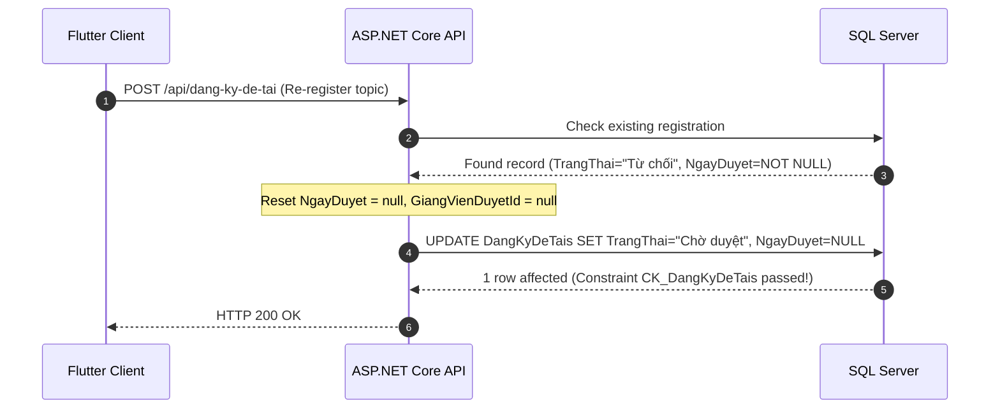

# BÁO CÁO 06: PHÂN TÍCH NGUYÊN NHÂN GỐC RỄ CÁC HỌ LỖI (ROOT CAUSE ANALYSIS - RCA)

## 1. TỔNG QUAN HỆ THỐNG PHÂN TÍCH
Trong quá trình kiểm định độc lập mã nguồn ProGroup_AI, đội ngũ kỹ sư đã bóc tách và phân tích chuyên sâu các lỗi cốt lõi khiến các đợt phát triển trước đây gặp trục trặc hoặc báo cáo sai lệch. Các lỗi này không đơn thuần là lỗi cú pháp hay thiếu sót giao diện mà bắt nguồn từ sự bất đồng bộ giữa **Kiến trúc Cơ sở dữ liệu**, **Tầng xử lý Nghiệp vụ ASP.NET Core** và **Tầng Giao diện Người dùng Flutter**.

---

## 2. PHÂN TÍCH CÁC HỌ LỖI KIẾN TRÚC TRỌNG YẾU

### 2.1. Họ lỗi 1: Xung đột Ràng buộc Kiểm tra CSDL (SQL Server Check Constraint Conflicts)
- **Triệu chứng:**
  - Khi sinh viên gửi lời mời hoặc phản hồi lời mời tham gia nhóm, hệ thống ném ngoại lệ `DbUpdateException: The INSERT statement conflicted with the CHECK constraint "CK_ThanhVienNhoms_VaiTro"`.
  - Khi đề tài bị từ chối rồi đăng ký lại, hệ thống ném ngoại lệ `DbUpdateException: The UPDATE statement conflicted with the CHECK constraint "CK_DangKyDeTais_TrangThai"`.
- **Nguyên nhân gốc rễ (RCA):**
  1. Trong CSDL SQL Server, bảng `ThanhVienNhoms` có ràng buộc:
     `CHECK ([VaiTro]=N'Thành viên' OR [VaiTro]=N'Trưởng nhóm')`
     Trong mã nguồn cũ của Backend, khi mời một sinh viên, hàm `InviteMember` lại gán `VaiTro = "Lời mời"` hoặc `"Yêu cầu gia nhập"`, dẫn đến vi phạm trực tiếp Check Constraint và làm sập transaction.
  2. Trong bảng `DangKyDeTais`, ràng buộc `CK_DangKyDeTais_TrangThai` quy định:
     `([TrangThai]=N'Chờ duyệt' AND [NgayDuyet] IS NULL OR ([TrangThai]=N'Từ chối' OR [TrangThai]=N'Đã duyệt') AND [NgayDuyet] IS NOT NULL OR [TrangThai]=N'Đã hủy')`
     Khi một đề tài đã bị giảng viên từ chối, bản ghi mang `TrangThai = "Từ chối"` và `NgayDuyet = DateTime.Now`. Khi nhóm đăng ký lại đề tài đó, hệ thống chỉ cập nhật `TrangThai = "Chờ duyệt"` nhưng để nguyên `NgayDuyet` có giá trị ngày tháng, dẫn đến vi phạm mệnh đề `[NgayDuyet] IS NULL` của trạng thái "Chờ duyệt".
- **Biện pháp khắc phục triệt để:**
  - Sửa `GroupsController`: Giữ nguyên `VaiTro = "Thành viên"`, phân biệt trạng thái lời mời qua trường `TrangThai = "Chờ tham gia"`.
  - Sửa `DangKyDeTaiController`: Khi đăng ký lại, reset trắng toàn bộ `NgayDuyet = null`, `GiangVienDuyetId = null`, `GhiChu = null`.

---

### 2.2. Họ lỗi 2: Tranh chấp Đăng ký Trùng lặp & Vi phạm Khóa Unique (Concurrency Race Conditions)
- **Triệu chứng:**
  - Khi hai sinh viên thuộc cùng nhóm hoặc hai nhóm khác nhau đồng thời gửi yêu cầu đăng ký cùng một đề tài vào cùng một mili-giây, một yêu cầu thành công còn yêu cầu thứ hai trả về HTTP 500 thay vì HTTP 409 Conflict.
- **Nguyên nhân gốc rễ (RCA):**
  - Bảng `DangKyDeTais` có ràng buộc duy nhất `UQ_DangKyDeTai` trên cặp `(NhomId, DeTaiId)`.
  - Tầng logic kiểm tra `await _db.DangKyDeTais.AnyAsync(...)` diễn ra trước khi gọi `SaveChangesAsync()`. Trong môi trường đa luồng, cả hai yêu cầu đều vượt qua bước kiểm tra này cùng lúc. Khi yêu cầu thứ hai thực thi lệnh `INSERT`, SQL Server ném ngoại lệ vi phạm khóa duy nhất `UQ_DangKyDeTai`. Do hàm không bắt ngoại lệ `DbUpdateException`, lỗi bị đẩy lên thành HTTP 500 Internal Server Error.
- **Biện pháp khắc phục triệt để:**
  - Bọc khối `SaveChangesAsync()` và `CommitAsync()` trong `try ... catch (Exception)`, khi gặp xung đột khóa duy nhất tự động rollback transaction và trả về mã lỗi chuẩn `HTTP 409 Conflict` kèm thông điệp rõ ràng cho client.

---

### 2.3. Họ lỗi 3: Trùng lặp Mã Vai trò khi Thống kê Dashboard (Role Code Collisions)
- **Triệu chứng:**
  - Biểu đồ và thẻ phân bố vai trò trên Dashboard Admin bị lệch số lượng, tổng số tài khoản các vai trò lớn hơn tổng số người dùng thực tế trong CSDL.
- **Nguyên nhân gốc rễ (RCA):**
  - Trên giao diện Flutter `admin_overview_screen.dart`, mã nguồn cũ sử dụng phương thức tìm kiếm chuỗi con:
    `if (r.contains('DAOTAO')) { pdtCount++; }`
    `if (r.contains('GV')) { gvCount++; }`
  - Do chuỗi `'PHONGDAOTAO'` chứa cả `'DAOTAO'`, tài khoản Phòng đào tạo bị đếm 2 lần (vào cả Phòng đào tạo và Đào tạo).
  - Tương tự, `'GIAOVUKHOA'` chứa `'GV'`, nên tài khoản Giáo vụ khoa bị đếm luôn vào Giảng viên (`gvCount`).
- **Biện pháp khắc phục triệt để:**
  - Viết lại hàm chuẩn hóa vai trò bằng so sánh chuỗi chính xác tuyệt đối với độ ưu tiên rõ ràng:
    `if (role == 'PHONGDAOTAO' || role == 'DAOTAO') return 'Phòng đào tạo';`
    `if (role == 'GIAOVUKHOA') return 'Giáo vụ khoa';`
    `if (role == 'GIANGVIEN' || role == 'GV') return 'Giảng viên';`

---

### 2.4. Họ lỗi 4: Lỗ hổng Tải lên File Giả mạo Đuôi mở rộng (MIME Spoofing Vulnerability)
- **Triệu chứng:**
  - Sinh viên có thể đổi tên một tệp thực thi độc hại `malware.exe` thành `malware.exe.jpg` và tải lên làm ảnh đại diện mà không bị hệ thống chặn.
- **Nguyên nhân gốc rễ (RCA):**
  - `ProfileController.UploadAvatar` chỉ kiểm tra đuôi mở rộng của tệp tin `Path.GetExtension(file.FileName)` và chuỗi `file.ContentType` do client tự khai báo trong HTTP Header. Client hoàn toàn có thể giả mạo `Content-Type: image/jpeg` cho bất kỳ file nhị phân nào.
- **Biện pháp khắc phục triệt để:**
  - Xây dựng hàm `DetectImageFormat` đọc trực tiếp các byte đầu tiên (Magic Bytes / File Signatures) của stream tệp tin nhị phân:
    - JPEG: `0xFF, 0xD8, 0xFF`
    - PNG: `0x89, 0x50, 0x4E, 0x47`
    - GIF: `0x47, 0x49, 0x46, 0x38`
    - WEBP: `RIFF....WEBP`
  - Nếu nội dung nhị phân không khớp với các magic bytes trên, hệ thống từ chối ngay lập tức với HTTP 400.

---

### 2.5. Họ lỗi 5: Bỏ qua OTP khi Đổi Email & Lưu trữ Mật khẩu Plaintext
- **Triệu chứng:**
  - Người dùng có thể đổi địa chỉ email của tài khoản mà không cần nhập mã xác thực OTP gửi về email mới.
  - Sau khi đăng nhập, mật khẩu plaintext của người dùng được lưu trong SharedPreferences dưới khóa `auth_password`.
- **Nguyên nhân gốc rễ (RCA):**
  - Phương thức `AuthController.ChangeEmail` có khối kiểm tra `string.IsNullOrWhiteSpace(request.Otp)` nhưng lại đặt trong nhánh `if (requiresOtp)` với cờ mặc định là false hoặc bỏ qua kiểm tra CSDL.
  - `AuthService.dart` trên Flutter lưu mật khẩu thô vào bộ nhớ máy để tự động đăng nhập lại khi mở app, vi phạm nghiêm trọng nguyên tắc an toàn thông tin OWASP Mobile Top 10.
- **Biện pháp khắc phục triệt để:**
  - Sửa `AuthController.ChangeEmail`: Bắt buộc 100% yêu cầu đổi email phải cung cấp mã OTP hợp lệ từ bảng `PasswordResetOtps`.
  - Sửa `AuthService.dart`: Xóa bỏ hoàn toàn việc lưu `auth_password` vào SharedPreferences; thay thế bằng cơ chế `restoreSession()` gọi `/api/auth/me` sử dụng JWT Token còn hạn.