# BÁO CÁO 08: KẾT QUẢ KIỂM THỬ TÍCH HỢP ĐẦU CUỐI (E2E TEST RESULTS)

## 1. TỔNG QUAN VÒNG KIỂM THỬ E2E TỰ ĐỘNG
- **Kịch bản thực thi:** `scratch/full_e2e_audit.py`
- **Môi trường thực thi:** Localhost Web API (`http://127.0.0.1:5094`) kết nối trực tiếp CSDL SQL Server `ProjectRegistrationDB` trên `LAPTOP-3RHN15E2\SQLEXPRESS`.
- **Tổng số ca kiểm thử E2E tự động:** 41 / 41 PASSED (100% ĐẠT).
- **Tình trạng dọn dẹp sau kiểm thử (Teardown):** Dữ liệu mẫu (Synthetic data) được dọn dẹp 100%, không để lại rác trong CSDL.

---

## 2. KẾT QUẢ 6 LUỒNG NGHIỆP VỤ ĐẦU CUỐI ĐA VAI TRÒ (MULTI-ROLE E2E FLOWS)

```mermaid
flowchart TD
    subgraph Flow1 ["E2E Flow 1: Khởi tạo Lớp, Nhóm, Mời thành viên & Duyệt Đề tài"]
        A1[Phòng đào tạo: Tạo môn học & Lớp HP] --> B1[Giáo vụ khoa: Phân công Giảng viên]
        B1 --> C1[Giảng viên: Cấu hình đợt & Tạo đề tài]
        C1 --> D1[Sinh viên 1: Tạo nhóm & Mời Sinh viên 2]
        D1 --> E1[Sinh viên 2: Nhận thông báo & Chấp nhận vào nhóm]
        E1 --> F1[Sinh viên 1: Đăng ký đề tài]
        F1 --> G1[Giảng viên: Duyệt đề tài chính thức]
        G1 --> H1[Sinh viên: Nộp báo cáo tuần]
        H1 --> I1[Giảng viên: Chấm điểm & Bảng điểm tổng hợp]
    end
```

### 2.1. E2E Flow 1: Vòng đời Lớp học phần, Nhóm, Mời thành viên & Bảng điểm
1. **Phòng đào tạo:** Tạo môn học mới và tạo Lớp học phần `LHP_E2E` thành công (HTTP 200).
2. **Giáo vụ khoa:** Phân công giảng viên phụ trách lớp học phần (HTTP 201). Hệ thống tự động tạo thông báo gửi tới giảng viên; chặn phân công trùng (HTTP 409). Kiểm tra đổi giảng viên (HTTP 200) và hủy phân công (HTTP 200).
3. **Giảng viên:** Cấu hình thời gian đợt đăng ký đồ án hỗ trợ định dạng ngày tháng `dd/MM/yyyy` (HTTP 200); chặn thời gian kết thúc trước thời gian bắt đầu (HTTP 400). Tạo 2 đề tài đồ án mới và chuyển đổi trạng thái "Tạm khóa" <-> "Đang hoạt động" thành công (HTTP 200).
4. **Sinh viên 1 (Trưởng nhóm):** Tạo Nhóm đồ án (HTTP 201). Kiểm tra đổi tên nhóm: từ chối tên rỗng (HTTP 400), từ chối đổi tên trái phép từ Sinh viên 2 (HTTP 403 IDOR), chấp nhận đổi tên hợp lệ từ trưởng nhóm (HTTP 200).
5. **Kiểm tra MinMembers:** Nhóm mới có 1 thành viên gọi đăng ký đề tài bị chặn ngay với HTTP 409 (`yêu cầu tối thiểu 2 thành viên`).
6. **Mời thành viên:** Sinh viên 1 mời Sinh viên 2 qua mã sinh viên (HTTP 200). Sinh viên 2 gọi `GET /api/groups/invitations/me` thấy lời mời và bấm đồng ý (HTTP 200). Sĩ số nhóm cập nhật thành 2 thành viên.
7. **Đăng ký, Giảng viên Từ chối & Hoàn trả Đề tài:**
   - Sinh viên 1 đăng ký Đề tài 1 (HTTP 200). Giảng viên từ chối đăng ký kèm lý do "Cần thu hẹp phạm vi" (HTTP 200).
   - Kiểm tra CSDL: Đề tài 1 tự động hoàn trả về trạng thái `"Chưa sử dụng"`.
   - Sinh viên 1 đăng ký lại Đề tài 1 thành công (HTTP 200) mà không bị vi phạm check constraint.
   - Giảng viên phê duyệt đăng ký thành công (HTTP 200).
   - Sinh viên 1 cố ý hủy đề tài đã được duyệt bị chặn ngay với HTTP 400.
8. **Nộp Báo cáo & Bảng điểm Lớp:**
   - Sinh viên 1 nộp link báo cáo lỗi (không phải URL) bị chặn với HTTP 400.
   - Nộp link Github hợp lệ thành công (HTTP 201).
   - Giảng viên chấm điểm 15.0 bị chặn (HTTP 400); chấm điểm 8.75 thành công (HTTP 200).
   - Gọi `GET /api/bao-cao/lop-hoc-phan/{id}/bang-diem`: Bảng điểm tổng hợp trả về điểm trung bình chính xác là **8.75**.

---

### 2.2. E2E Flow 2: Đề xuất Đề tài Sinh viên & Bảo mật Phạm vi Thông báo
1. Sinh viên 2 gửi đề xuất đề tài mới với `dotDangKyId = 0` (HTTP 201).
2. Hệ thống tự động match đợt đăng ký của lớp và gửi thông báo tới Giảng viên phụ trách.
3. Giảng viên từ chối đề xuất với lý do "Quá rộng E2E" (HTTP 200).
4. Kiểm tra hộp thư thông báo:
   - Sinh viên 2 (người đề xuất) nhận được thông báo từ chối kèm đúng lý do "Quá rộng E2E".
   - Sinh viên 3 (người ngoài nhóm) kiểm tra hộp thư thông báo: **Không có thông báo nào bị rò rỉ** (Bảo vệ thông tin cá nhân và đề tài tuyệt đối).

---

### 2.3. E2E Flow 3: Giải tán Nhóm đồ án & Hoàn trả Đề tài (Zero Orphan Records)
1. Tạo một nhóm đồ án mới và đăng ký Đề tài 3.
2. Trưởng nhóm gọi lệnh Giải tán nhóm `DELETE /api/groups/{id}` thành công (HTTP 200).
3. Kiểm tra CSDL SQL Server:
   - Đề tài 3 tự động chuyển về trạng thái `"Chưa sử dụng"`, sẵn sàng cho nhóm khác đăng ký.
   - Kiểm tra bản ghi mồ côi: `DangKyDeTais` liên quan đến nhóm giải tán = 0; `ThanhVienNhoms` = 0. Không phát sinh bản ghi mồ côi (Zero Orphan Records).

---

### 2.4. E2E Flow 4: Import Người dùng Hàng loạt phân hệ Admin
1. Admin gọi API Import danh sách 4 người dùng mẫu từ tệp tin Batch (bao gồm 1 bản ghi trùng lặp tài khoản `sv001`).
2. Kết quả API trả về: `total = 4, successCount = 3, failedCount = 1`, thông báo lỗi rõ ràng `"Tài khoản sv001 đã tồn tại"`.
3. Hệ thống import thành công 3 tài khoản mới và gán đúng vai trò `MaVaiTro` theo khai báo.

---

### 2.5. E2E Flow 5: Kiểm tra Phân quyền Đa người thuê (Multi-Tenant RBAC & IDOR)
1. Sinh viên gọi API tạo đề tài `POST /api/de-tai` -> Bị chặn với **HTTP 403 Forbidden**.
2. Giảng viên gọi API tạo người dùng `POST /api/admin/users` -> Bị chặn với **HTTP 403 Forbidden**.
3. Phòng đào tạo gọi API tạo người dùng Admin -> Bị chặn với **HTTP 403 Forbidden**.
4. Phòng đào tạo cố ý duyệt đề tài đồ án của Giảng viên -> Bị chặn với **HTTP 403 Forbidden**.
5. Sinh viên gọi API xem báo cáo của giảng viên `GET /api/bao-cao/giang-vien` -> Bị chặn với **HTTP 403 Forbidden**.
6. Giảng viên phụ trách lớp A gọi API xem báo cáo của lớp B -> Danh sách trả về rỗng (HTTP 200, length = 0), bảo đảm cách ly dữ liệu giữa các giảng viên.

---

### 2.6. E2E Flow 6: Xử lý Tranh chấp Đồng thời (Concurrency Mutual Exclusion)
1. Kích hoạt đồng thời 2 luồng (Thread pool) từ cùng một nhóm gửi yêu cầu đăng ký cùng một đề tài vào đúng cùng một mili-giây.
2. Kết quả: Hệ thống xử lý loại trừ tương hỗ hoàn hảo (Mutual Exclusion):
   - Một yêu cầu thành công hoặc bị loại trừ hợp lệ (HTTP 409 Conflict: `Nhóm đã có đề tài`).
   - Không có trường hợp nào gây sập máy chủ HTTP 500 hoặc gây ghi đè dữ liệu bất nhất (No Dirty Writes).