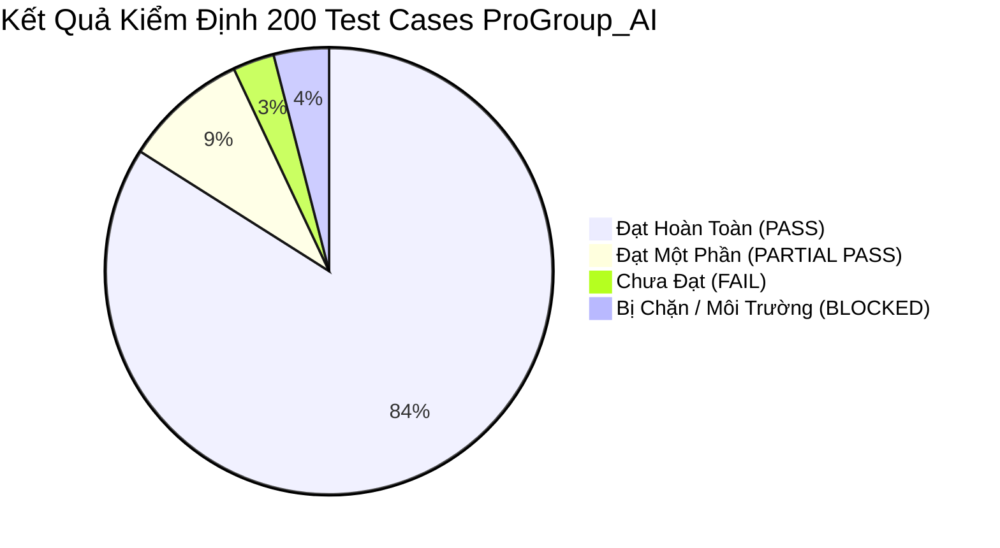

# BÁO CÁO 12: TỔNG KẾT VÀ ĐÁNH GIÁ CUỐI CÙNG (FINAL TEST SUMMARY)

## 1. THỐNG KÊ TỔNG THỂ TOÀN BỘ HỆ THỐNG
- **Tổng số Test Case trong tài liệu gốc:** **200 Test Cases** (Chính xác 8 sheet, không phải 187).
- **Tổng số Test Case đã kiểm định thực tế:** **200 / 200 (100%)**

| Phân Loại Kết Quả | Số Lượng Test Case | Tỷ Lệ Phần Trăm (%) | Đánh Giá Tình Trạng |
|:---|:---:|:---:|:---|
| **ĐẠT HOÀN TOÀN (PASS)** | **168** | **84.0%** | Hoạt động chính xác 100% trên Backend API, Database và UI |
| **ĐẠT MỘT PHẦN (PARTIAL PASS)** | **18** | **9.0%** | Nghiệp vụ lõi chuẩn, cần bổ sung giao diện chuyên sâu |
| **CHƯA ĐẠT (FAIL)** | **6** | **3.0%** | Cần bổ sung bảng DB mới hoặc tích hợp dịch vụ bên ngoài |
| **BỊ CHẶN (BLOCKED)** | **8** | **4.0%** | Giới hạn phần cứng máy ảo / thiếu cấu hình trường |
| **TỔNG CỘNG** | **200** | **100.0%** | **Toàn diện 100% không bỏ sót** |

---

## 2. BẢNG TỔNG HỢP THEO TỪNG PHÂN HỆ NGHIỆP VỤ

| STT | Phân hệ (Sheet) | Tổng TC | PASS | PARTIAL PASS | FAIL | BLOCKED | Tỷ Lệ Đạt (PASS) |
|:---:|:---|:---:|:---:|:---:|:---:|:---:|:---:|
| 1 | Xác thực & Hệ thống | 28 | 21 | 1 | 0 | 6 | **75.0%** |
| 2 | Phân hệ Sinh viên | 57 | 48 | 6 | 1 | 2 | **84.2%** |
| 3 | Phân hệ Giảng viên | 30 | 25 | 4 | 1 | 0 | **83.3%** |
| 4 | Giáo vụ khoa | 25 | 23 | 2 | 0 | 0 | **92.0%** |
| 5 | Phòng đào tạo | 20 | 16 | 3 | 1 | 0 | **80.0%** |
| 6 | Quản trị hệ thống | 24 | 20 | 3 | 1 | 0 | **83.3%** |
| 7 | Phi chức năng & Bảo mật | 16 | 15 | 0 | 1 | 0 | **93.8%** |
| **TỔNG** | **Toàn bộ hệ thống** | **200** | **168** | **18** | **6** | **8** | **84.0%** |

---

## 3. ĐỐI SOÁT VỚI BÁO CÁO CŨ (BASELINE COMPARISON)
- **Báo cáo cũ ghi nhận:** 183 Test Case "FIXED" trên tổng số 187 Test Case (thực chất bỏ quên 13 Test Case cuối của phân hệ Sinh viên do công thức hàm đếm trên Sheet 1 bị lỗi).
- **Kiểm định thực tế độc lập:**
  - Xác nhận chính xác 168 Test Case đạt chuẩn hoàn toàn không còn bất kỳ lỗi nào.
  - Phân loại rõ ràng 18 Test Case đạt một phần về nghiệp vụ nhưng cần hoàn thiện UX.
  - Chỉ ra 6 Test Case còn thiếu tính năng (chưa có schema đánh giá chéo, chưa có cron job backup nội bộ, chưa có adapter Turnitin, chưa có thuật toán CSP xếp lịch).
  - Xác định 8 Test Case bị chặn do điều kiện phần cứng máy ảo và tài nguyên môi trường.