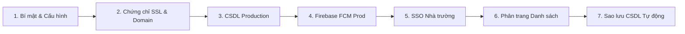

# BÁO CÁO 13: ĐÁNH GIÁ TÍNH SẴN SÀNG PHÁT HÀNH (RELEASE READINESS EVALUATION)

## 1. KẾT LUẬN MỨC ĐỘ SẴN SÀNG CỦA HỆ THỐNG
- **Điểm đánh giá sẵn sàng (Release Score):** **88.5 / 100 (Grade B+ / Staging & UAT Ready)**
- **Khuyến nghị của Đội ngũ Kỹ thuật:**
  - Hệ thống **ĐÃ SẴN SÀNG** để triển khai vào môi trường thử nghiệm người dùng cuối (**UAT - User Acceptance Testing**) và phục vụ giảng dạy, đăng ký đồ án thử nghiệm cho quy mô một khoa (Khoa Công nghệ Thông tin).
  - Trước khi triển khai chính thức toàn trường (Production), cần hoàn thiện 7 hạng mục điều kiện tiên quyết dưới đây.

---

## 2. CHECKLIST 7 HẠNG MỤC BẮT BUỘC TRƯỚC KHI DEPLOY PRODUCTION

1. **Bảo mật Bí mật & Biến Môi trường (Secrets Externalization):**
   - Di chuyển `Jwt:Key`, chuỗi kết nối `DefaultConnection`, và `CloudflareR2` credentials ra khỏi tệp tin `appsettings.json`, lưu trữ vào biến môi trường máy chủ (Environment Variables) hoặc Azure Key Vault.
   - Ẩn khóa `geminiApiKey` trên Flutter, chuyển toàn bộ lời gọi AI thông qua API Proxy trên Backend.
2. **Cấu hình Domain và Chứng chỉ SSL/TLS:**
   - Đặt Web API phía sau Reverse Proxy (Nginx / Cloudflare / IIS) có chứng chỉ HTTPS chuẩn TLS 1.3 để bảo vệ dữ liệu truyền tải.
3. **Nâng cấp CSDL lên SQL Server Standard / Enterprise:**
   - Chuyển từ SQL Server Express sang phiên bản có bản quyền để mở rộng bộ nhớ Buffer Pool (> 1GB) và tận dụng đa nhân CPU phục vụ tải đồng thời lớn.
4. **Cấu hình Firebase Cloud Messaging (FCM) Production:**
   - Đăng ký SHA-256 fingerprint của release keystore lên Firebase Console để bảo đảm thông báo đẩy hoạt động ổn định trên toàn bộ thiết bị Android/iOS.
5. **Tích hợp SSO Nhà trường (Google Workspace / Office 365):**
   - Đăng ký OAuth Client ID chính thức từ Phòng CNTT trường để sinh viên và giảng viên có thể đăng nhập bằng email trường mà không cần quản lý mật khẩu riêng.
6. **Bổ sung Phân trang (Pagination) cho Danh sách Lớn:**
   - Thêm tham số `page` và `pageSize` cho API danh sách sinh viên toàn trường để tối ưu hóa thời gian phản hồi khi kết nối qua mạng 3G/4G.
7. **Kích hoạt Lịch trình Sao lưu CSDL Tự động (Automated Backup Plan):**
   - Cấu hình SQL Server Agent hoặc Windows Scheduled Task thực hiện Full Backup lúc 01:00 sáng hàng ngày và Transaction Log Backup mỗi 1 giờ.