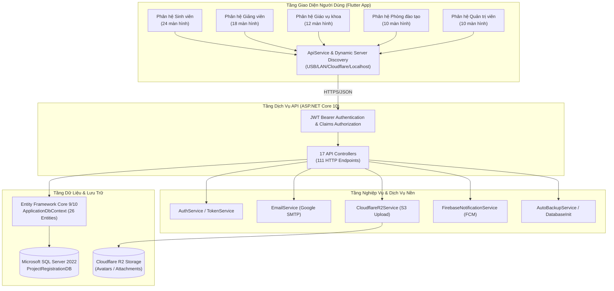

# 01. BÁO CÁO KHẢO SÁT KIẾN TRÚC TOÀN BỘ HỆ THỐNG (SYSTEM ARCHITECTURE OVERVIEW)

## 1. TỔNG QUAN HỆ THỐNG
**ProGroup_AI** là hệ thống quản lý và hỗ trợ sinh viên đăng ký học phần, lập nhóm và đăng ký đề tài nghiên cứu/đồ án môn học tích hợp công nghệ AI. Hệ thống được xây dựng theo mô hình Client-Server đa nền tảng (Mobile/Desktop App kết nối RESTful Web API).

- **Frontend:** Flutter SDK (Dart 3.x), hỗ trợ Android, iOS, Windows Desktop, Web.
- **Backend:** ASP.NET Core 10 Web API, kiến trúc Layered/Clean Architecture.
- **Database:** Microsoft SQL Server 2022 (EF Core 9/10 Object-Relational Mapping).
- **Lưu trữ đám mây & Dịch vụ ngoài:** Cloudflare R2 (S3 Compatible API), Firebase Cloud Messaging (FCM Admin SDK), Google SMTP Service.

---

## 2. SƠ ĐỒ KIẾN TRÚC TỔNG THỂ (MERMAID DIAGRAM)

---

## 3. CHI TIẾT TỪNG PHÂN TẦNG HỆ THỐNG

### 3.1. Tầng Trình Diễn (Frontend - Flutter)
- **Cấu trúc thư mục:** `ProGroup_AI_Frontend/progroup_ai_frontend/lib/`
  - `screens/`: 74 file màn hình giao diện phân theo 5 role (`sinh_vien`, `lecturer`, `giao_vu`, `phong_dao_tao`, `admin`) và module `auth`.
  - `services/`: 11 file service xử lý mạng (`api_service.dart`, `auth_service.dart`, `student_api_service.dart`, `lecturer_api_service.dart`, `governance_api_service.dart`, `admin_api_service.dart`, `avatar_service.dart`, `notification_service.dart`, `app_update_service.dart`, `network_service.dart`).
  - `models/`: 16 model/DTO định nghĩa thực thể trên client (`user_model.dart`, `course_model.dart`, `group_model.dart`, `topic_model.dart`, `admin_account_model.dart`, `user_profile_model.dart`,...).
  - `data/`: 11 file Mock Data tĩnh (`mock_courses.dart`, `mock_groups.dart`, `mock_topics.dart`, `mock_users.dart`, `mock_notifications.dart`, `mock_reports.dart`, `mock_analytics.dart`, `mock_roles.dart`, `mock_activity_logs.dart`, và mock riêng của PĐT & Giáo vụ).
- **Quản lý trạng thái (State Management):**
  - Sử dụng kết hợp `StatefulWidget` với `setState` cục bộ và `Provider` / Singleton Service (`AuthService`, `ApiService.instance`).
- **Cơ chế phát hiện mạng (Server Discovery):**
  - `ApiService.autoDetectServer()` tự động ping tuần tự qua các URL ứng cử viên: USB Port Forwarding (`127.0.0.1:5094`), Android Emulator (`10.0.2.2:5094`), Localhost (`localhost:5094`), LAN IP Wi-Fi (`192.168.1.234:5094`), và Cloudflare Tunnel URL.

### 3.2. Tầng Ứng Dụng & API (Backend - ASP.NET Core 10)
- **Cấu trúc Controller (17 Controllers, 111 Endpoints):**
  1. `AdminController` (11 endpoints): Quản trị người dùng, thống kê hệ thống, đổi vai trò, khóa tài khoản.
  2. `AuthController` (7 endpoints): Đăng nhập, thông tin tài khoản (`/me`), đổi mật khẩu, quên mật khẩu (OTP), đổi email.
  3. `BaoCaoTienDoController` (5 endpoints): Nộp báo cáo tiến độ, danh sách báo cáo theo nhóm/giảng viên, chấm điểm báo cáo.
  4. `DangKyDeTaiController` (17 endpoints): Đăng ký đề tài, duyệt/từ chối đề tài, danh sách đăng ký.
  5. `DeTaiController` (11 endpoints): CRUD đề tài, đề xuất đề tài sinh viên, danh sách đề tài của giảng viên.
  6. `DotDangKyController` (8 endpoints): Quản lý đợt đăng ký đề tài theo lớp học phần.
  7. `EmailTestController` (3 endpoints): Kiểm thử dịch vụ email.
  8. `GiangVienController` (4 endpoints): Danh sách giảng viên, chi tiết giảng viên.
  9. `GroupsController` (18 endpoints): CRUD nhóm sinh viên, mời thành viên, xin vào nhóm, rời nhóm, giải tán nhóm.
  10. `LecturerController` (3 endpoints): Danh sách lớp, thống kê giảng viên, đăng ký đề tài cho giảng viên.
  11. `LopHocPhanController` (7 endpoints): Quản lý lớp học phần, học kỳ, phân công giảng viên.
  12. `NotificationsController` (4 endpoints): Danh sách thông báo, đánh dấu đã đọc, số lượng chưa đọc.
  13. `ProfileController` (3 endpoints): Xem hồ sơ cá nhân, cập nhật thông tin, upload avatar.
  14. `ProjectsController` (9 endpoints): Đăng ký và quản lý đồ án.
  15. `StudentController` (3 endpoints): Lớp học phần sinh viên, nhóm sinh viên, đề tài khả dụng.
  16. `AppVersionController` (1 endpoint): Kiểm tra phiên bản app và cập nhật.
  17. `TestController` (3 endpoints): Test kết nối database và phân quyền token.

### 3.3. Tầng Dữ Liệu (Database - SQL Server 2022)
- Quản lý qua Entity Framework Core 9/10 (`ApplicationDbContext`).
- **26 Bảng dữ liệu chính:**
  - Người dùng & Phân quyền: `NguoiDung`, `SinhVien`, `GiangVien`, `GiaoVuKhoa`, `PhongDaoTao`, `QuanTriVien`, `VaiTro`.
  - Học phần & Đào tạo: `LopHocPhan`, `HocKy`, `Khoa`, `Nganh`, `SinhVienLopHocPhan`.
  - Nhóm & Đề tài: `Nhom`, `ThanhVienNhom`, `LoiMoiNhom`, `YeuCauVaoNhom`, `DeTai`, `DangKyDeTai`, `DotDangKy`.
  - Tiến độ & Báo cáo: `BaoCaoTienDo`, `NhanXetBaoCao`, `LichSuBaoCao`.
  - Hệ thống & Tiện ích: `ThongBao`, `LichSuHeThong`, `CauHinhHeThong`, `AppVersion`.

---

## 4. TÍCH HỢP BÊN NGOÀI & DỊCH VỤ ĐÁM MÂY

| Dịch vụ | Mục đích sử dụng | File triển khai | Đánh giá bảo mật |
|---|---|---|---|
| **Cloudflare R2** | Lưu trữ ảnh đại diện, file tài liệu báo cáo | `CloudflareR2Service.cs` | ⚠️ **CỰC KỲ NGUY HIỂM:** Credentials Access Key / Secret Key bị commit trực tiếp trong `appsettings.json`! |
| **Firebase FCM** | Gửi thông báo đẩy (Push Notification) đến thiết bị mobile | `FirebaseNotificationService.cs` | ⚠️ **CỰC KỲ NGUY HIỂM:** Toàn bộ Private Key của Service Account bị lưu trong `Properties/firebase-admin-sdk.json`! |
| **Google SMTP** | Gửi mã OTP xác thực quên mật khẩu qua email | `EmailService.cs` | ⚠️ **CỰC KỲ NGUY HIỂM:** Mật khẩu ứng dụng Gmail (`fdwv lpjz pakd cifz`) bị lưu thô trong cấu hình! |
| **Cloudflare Tunnel** | Tunnel kết nối API cục bộ ra Internet cho thiết bị test | `api_service.dart:37` | ❌ **HỎNG:** URL trycloudflare đã hết hạn, gây chậm trễ 5s khi app cố gắng kết nối. |
