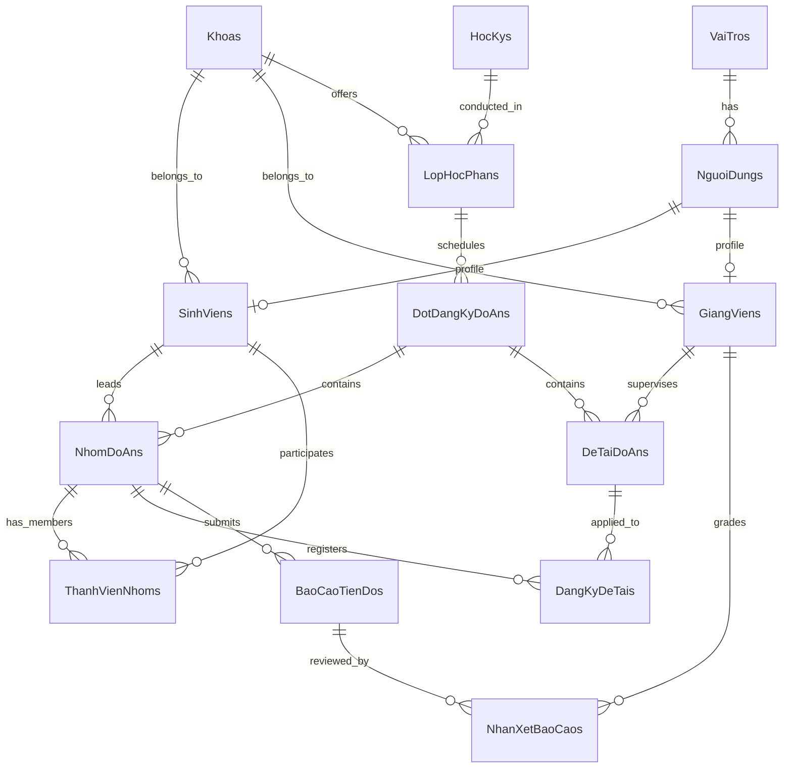

# 05. BÁO CÁO TOÀN VẸN CƠ SỞ DỮ LIỆU (DATABASE INTEGRITY AUDIT)
## SCHEMA ĐỐI CHIẾU, QUAN HỆ KHOÁ NGOẠI, DỮ LIỆU THỰC TẾ & TRANSACTIONS

---

### 1. MÔI TRƯỜNG VÀ DỮ LIỆU THỰC TẾ TRONG SQL SERVER
- **Hệ quản trị CSDL:** Microsoft SQL Server 2022 Express.
- **Instance:** `LAPTOP-3RHN15E2\SQLEXPRESS`.
- **Database:** `ProjectRegistrationDB`.
- **Thống kê dữ liệu thực tế (Real Live Data):**
  - Tổng số tài khoản (`NguoiDungs`): **284** tài khoản.
  - Sinh viên (`SinhViens`): **252** sinh viên.
  - Giảng viên (`GiangViens`): **6** giảng viên.
  - Quản trị viên (`ADMIN`): **2** tài khoản (`admin01`, `admin.demo`).
  - Giáo vụ khoa (`GIAOVUKHOA`): **2** tài khoản (`giaovu01`, `gvk.demo`).
  - Phòng đào tạo (`PHONGDAOTAO`): **2** tài khoản (`daotao01`, `pdt.demo`).
  - Khoa đào tạo (`Khoas`): **5** khoa (CNTT, KTPM, HTTT, KHMT, ATTT).
  - Lớp học phần (`LopHocPhans`): **12** lớp học phần đang hoạt động.
  - Đợt đăng ký đồ án (`DotDangKyDoAns`): **12** đợt đăng ký.
  - Đề tài đồ án (`DeTaiDoAns`): **52** đề tài đã được duyệt.
  - Nhóm đồ án (`NhomDoAns`): **28** nhóm đồ án đã thành lập.

---

### 2. CẤU TRÚC BẢNG VÀ MỐI QUAN HỆ TOÀN VẸN (17 TABLES)



#### Chi tiết các ràng buộc khóa ngoại (Foreign Key Constraints):
- `FK_SinhViens_NguoiDungs`: `SinhViens.NguoiDungId` -> `NguoiDungs.NguoiDungId` (ON DELETE CASCADE).
- `FK_GiangViens_NguoiDungs`: `GiangViens.NguoiDungId` -> `NguoiDungs.NguoiDungId` (ON DELETE CASCADE).
- `FK_NhomDoAns_SinhViens`: `NhomDoAns.TruongNhomId` -> `SinhViens.SinhVienId` (ON DELETE NO ACTION).
- `FK_ThanhVienNhoms_NhomDoAns`: `ThanhVienNhoms.NhomId` -> `NhomDoAns.NhomId` (ON DELETE CASCADE).
- `FK_DangKyDeTais_DeTaiDoAns`: `DangKyDeTais.DeTaiId` -> `DeTaiDoAns.DeTaiId` (ON DELETE CASCADE).
- `FK_DangKyDeTais_NhomDoAns`: `DangKyDeTais.NhomId` -> `NhomDoAns.NhomId` (ON DELETE NO ACTION).

---

### 3. KIỂM SOÁT TRANSACTIONS & TÍNH NHẤT QUÁN DỮ LIỆU
1. **Serializable Isolation Level:**
   - Tại `DeTaiController.cs`, phương thức `RegisterProject` thực thi trong transaction cấp cao nhất:
     ```csharp
     using var transaction = await _db.Database.BeginTransactionAsync(IsolationLevel.Serializable);
     ```
   - Điều này đảm bảo khi có nhiều request đồng thời, SQL Server sẽ khóa dòng dữ liệu (`Range S-U Lock`) ngăn ngừa hiện tượng Phantom Read và Dirty Write.
2. **Ngăn chặn trùng lặp thành viên:**
   - Cơ chế kiểm tra ràng buộc: Một sinh viên chỉ được tham gia tối đa 1 nhóm đang hoạt động trong cùng một đợt đăng ký đồ án (`DotDangKyId`).
